# СП-02 · Профайлинг: лицо, обман и культурный контекст — Галерея иллюстраций, карт FACS и инфографик

В этой папке собраны все **25 сгенерированных изображений** к пособию **«СП-02 · Профайлинг: лицо, обман и культурный контекст»**, разделённые по трём категориям:

1. **[`01_Annotated_FACS_Cards/`](./01_Annotated_FACS_Cards/)** — 10 диагностических карт лица по системе FACS с русскими выносками, формулами Action Units (AU), истинными и ложными признаками и примерами записи в протокол.
2. **[`02_Infographics_and_Schemas/`](./02_Infographics_and_Schemas/)** — 5 сводных аналитических инфографик (атлас 10 состояний, правда vs ложь по мета-анализу DePaulo et al., декодер трёх улыбок, ревизия НЛП по Wiseman et al., матрица 5 культурных регионов).
3. **[`03_Clean_Portraits_FACS/`](./03_Clean_Portraits_FACS/)** — 10 исходных студийных портретов одного и того же эталонного лица без текстовых плашек (для чистого сравнения мимики).

---

## I. Сводные аналитические инфографики и схемы (`02_Infographics_and_Schemas`)

### 1. Рис. II.0 — Сводный визуальный атлас 10 мимических состояний (FACS)
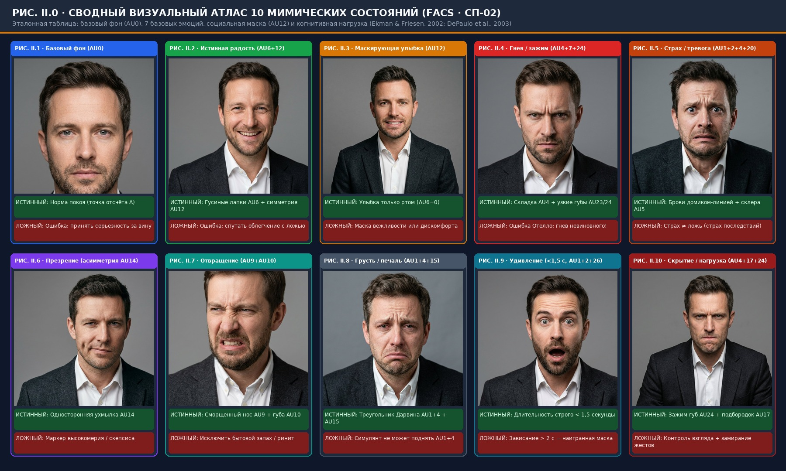

### 2. Рис. II.11 — Дифференциальная диагностика трёх улыбок (Дюшенн AU6+12 vs Маска AU12 vs Презрение AU14)
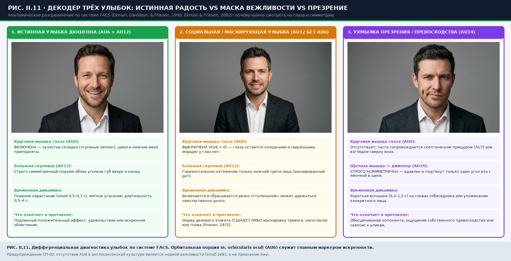

### 3. Рис. III.1 — Когда человек говорит правду vs когда врёт (мета-анализ 158 признаков, DePaulo et al., 2003)
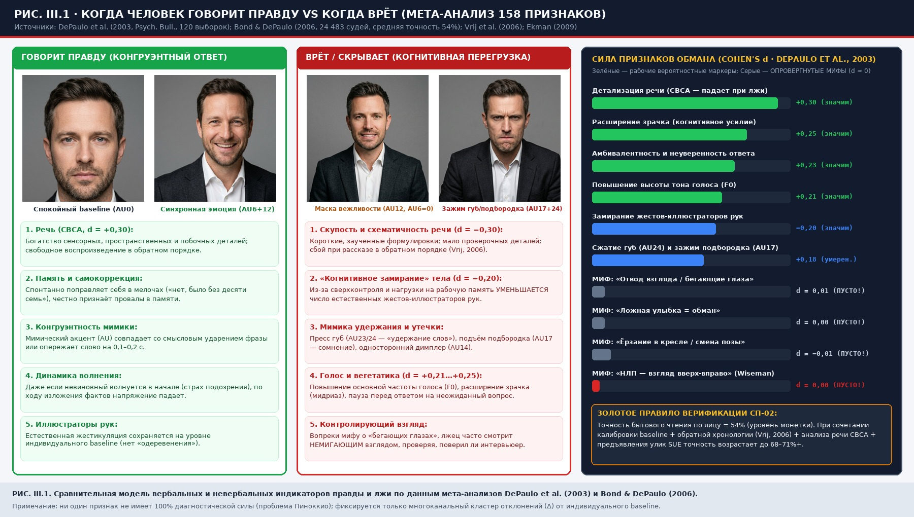

### 4. Рис. IV.1 — Опровержение глазодвигательной схемы лжи НЛП (Wiseman et al., 2012) и точность методов верификации
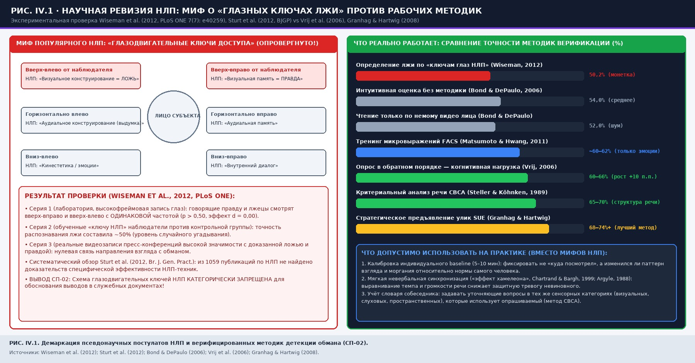

### 5. Рис. V.1 — Матрица регионального и кросс-культурного профайлинга (Славяне, Европа, США, Азия)
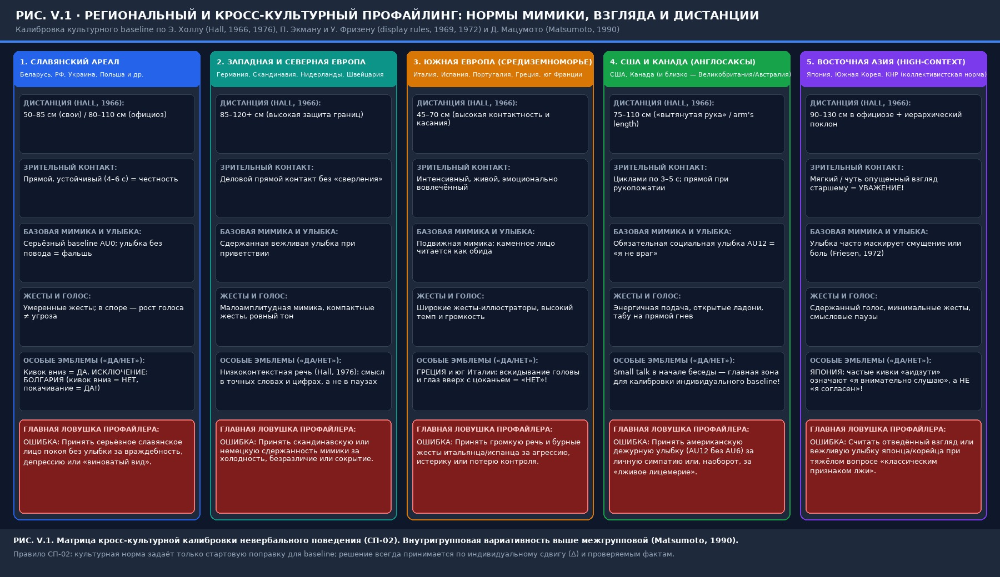

---

## II. 10 диагностических карт лица по системе FACS с расшифровкой (`01_Annotated_FACS_Cards`)

### Карта 1 (`card_01_baseline.jpg`) — Базовый фон покоя (Baseline, AU0)
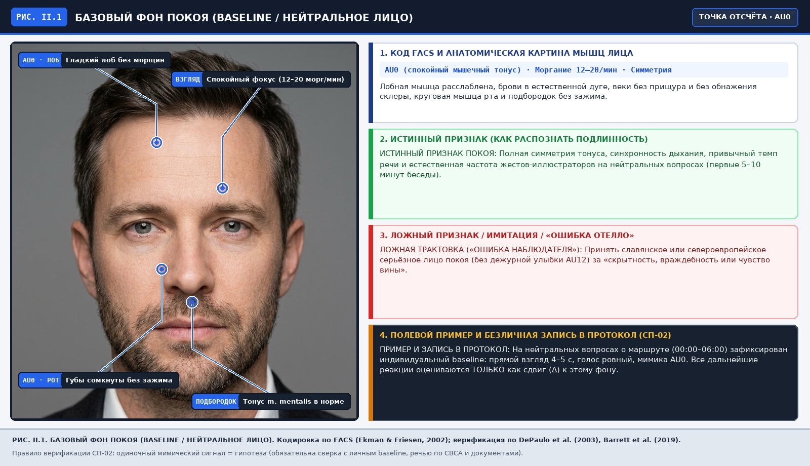

### Карта 2 (`card_02_joy_duchenne.jpg`) — Истинная радость (улыбка Дюшенна, AU6 + AU12)
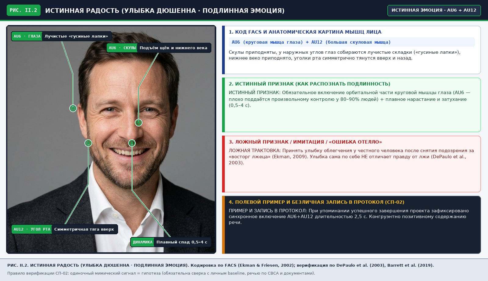

### Карта 3 (`card_03_social_mask_smile.jpg`) — Социальная / маскирующая улыбка (AU12 без AU6)
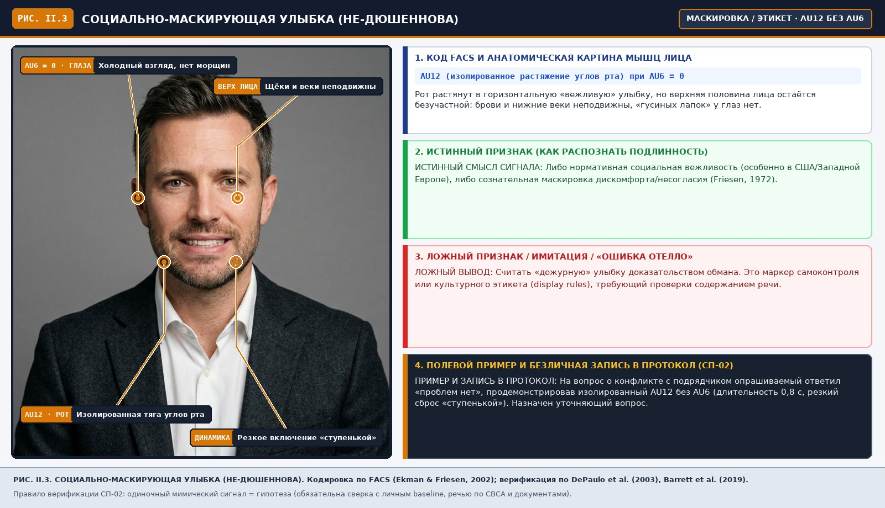

### Карта 4 (`card_04_anger_suppressed.jpg`) — Гнев и подавляемая злость (AU4 + AU5/7 + AU23/24)
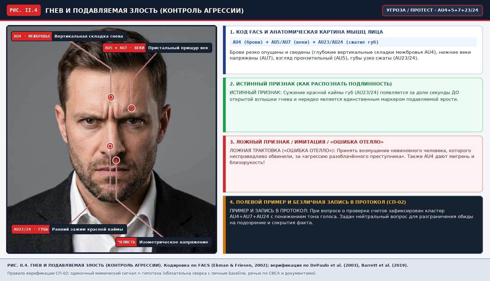

### Карта 5 (`card_05_fear_anxiety.jpg`) — Страх и опасение последствий (AU1+2+4 + AU5 + AU20)
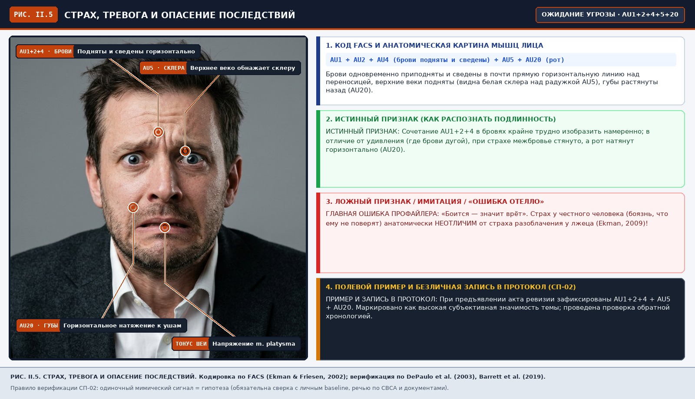

### Карта 6 (`card_06_contempt.jpg`) — Презрение и высокомерие (односторонний димплер AU14)
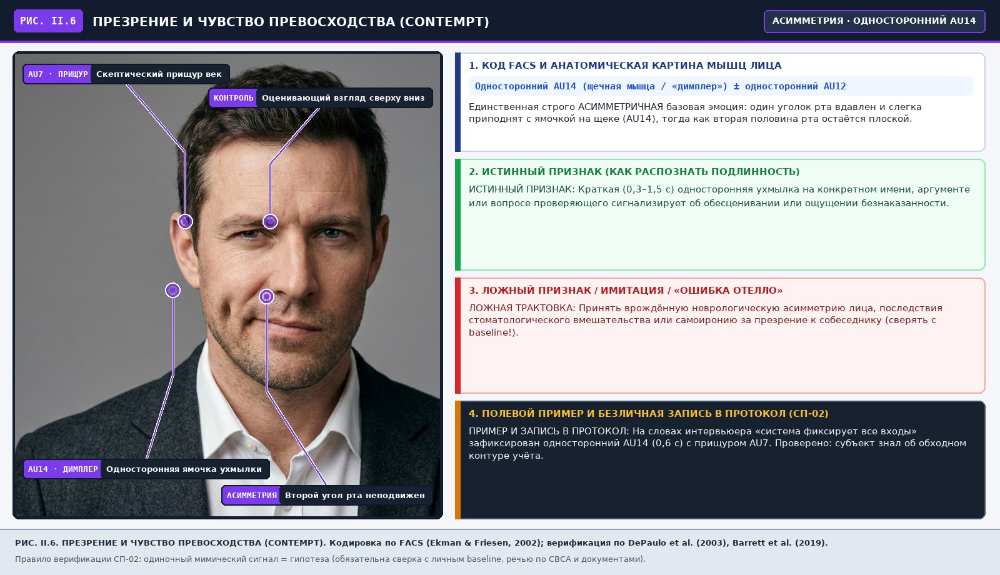

### Карта 7 (`card_07_disgust.jpg`) — Отвращение и моральное отторжение (AU9 + AU10)
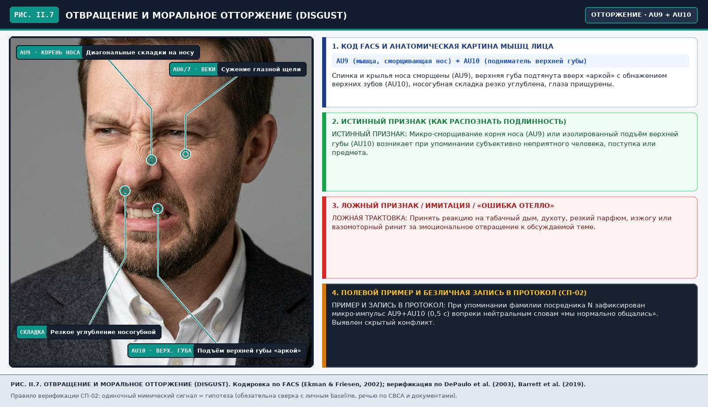

### Карта 8 (`card_08_sadness.jpg`) — Грусть и печаль («треугольник скорби Дарвина», AU1 + AU4 + AU15)
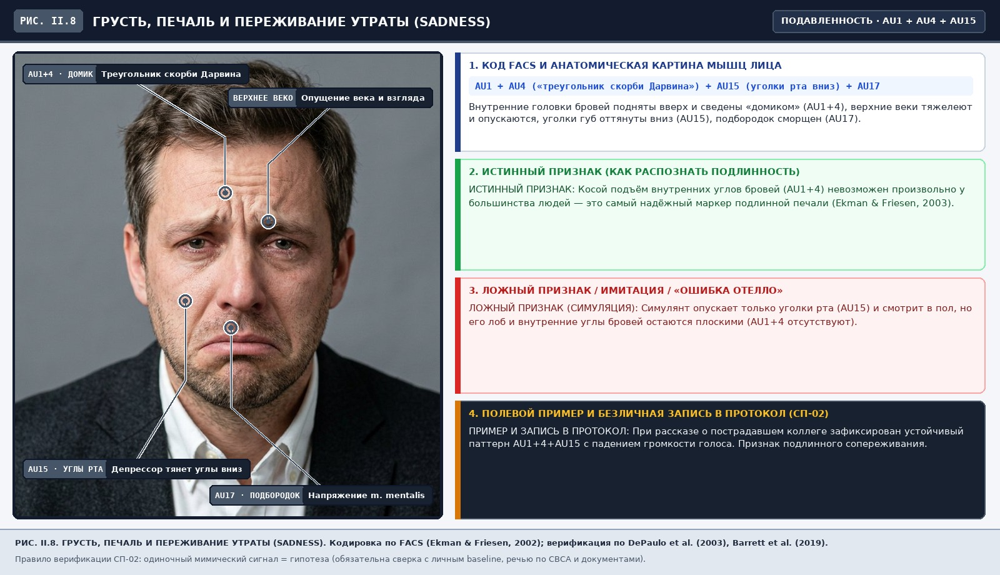

### Карта 9 (`card_09_surprise.jpg`) — Удивление: истинное (< 1,5 с) против наигранного (> 2 с)
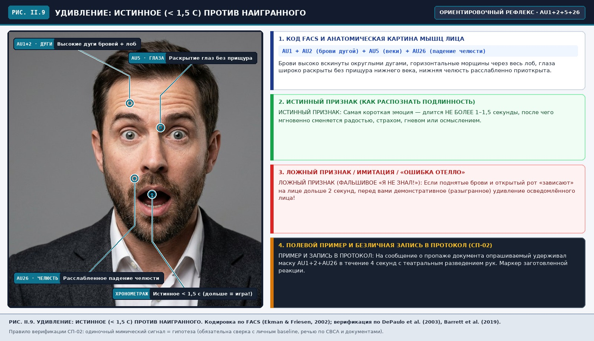

### Карта 10 (`card_10_deception_load.jpg`) — Когнитивная перегрузка и скрытие (AU4 + AU17 + AU24)
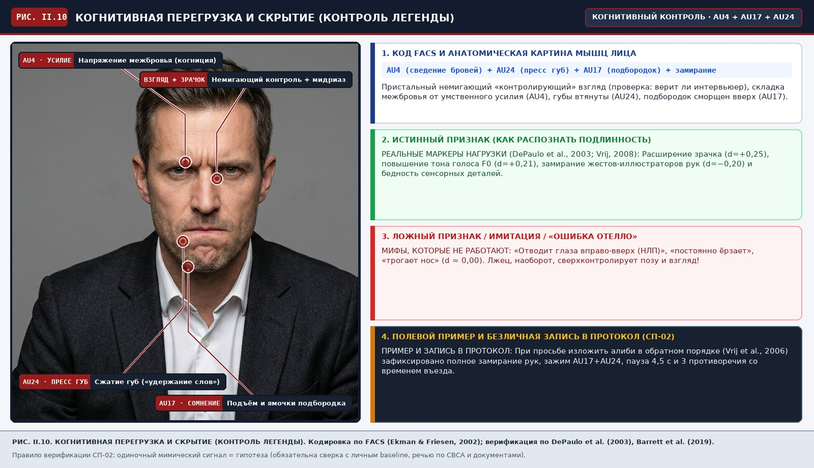

---

## III. 10 чистых студийных портретов без текстовых выносок (`03_Clean_Portraits_FACS`)

| № | Файл | Мимическое состояние и код FACS |
|---|---|---|
| 1 | [`face_01_baseline.jpg`](./03_Clean_Portraits_FACS/face_01_baseline.jpg) | Базовый фон покоя (`AU0`) |
| 2 | [`face_02_joy_duchenne.jpg`](./03_Clean_Portraits_FACS/face_02_joy_duchenne.jpg) | Истинная радость Дюшенна (`AU6 + AU12`) |
| 3 | [`face_03_social_mask_smile.jpg`](./03_Clean_Portraits_FACS/face_03_social_mask_smile.jpg) | Социальная / маскирующая улыбка (`AU12` при `AU6 = 0`) |
| 4 | [`face_04_anger_suppressed.jpg`](./03_Clean_Portraits_FACS/face_04_anger_suppressed.jpg) | Гнев и подавляемая злость (`AU4 + AU5 + AU7 + AU23/24`) |
| 5 | [`face_05_fear_anxiety.jpg`](./03_Clean_Portraits_FACS/face_05_fear_anxiety.jpg) | Страх и тревога (`AU1 + AU2 + AU4 + AU5 + AU20`) |
| 6 | [`face_06_contempt.jpg`](./03_Clean_Portraits_FACS/face_06_contempt.jpg) | Презрение (`односторонний димплер AU14`) |
| 7 | [`face_07_disgust.jpg`](./03_Clean_Portraits_FACS/face_07_disgust.jpg) | Отвращение (`AU9 + AU10`) |
| 8 | [`face_08_sadness.jpg`](./03_Clean_Portraits_FACS/face_08_sadness.jpg) | Грусть и печаль (`AU1 + AU4 + AU15`) |
| 9 | [`face_09_surprise.jpg`](./03_Clean_Portraits_FACS/face_09_surprise.jpg) | Удивление (`AU1 + AU2 + AU5 + AU26`) |
| 10 | [`face_10_deception_load.jpg`](./03_Clean_Portraits_FACS/face_10_deception_load.jpg) | Когнитивная перегрузка и скрытие (`AU4 + AU17 + AU24`) |
